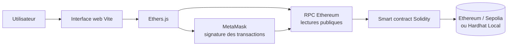

# AntiqueChain – Traçabilité des Antiquités sur Blockchain Ethereum

AntiqueChain est une application décentralisée (DApp) pédagogique consacrée à la traçabilité des antiquités. Un expert autorisé enregistre un objet et son premier propriétaire dans un smart contract Ethereum ; les propriétaires peuvent ensuite transférer l'objet, le mettre en vente ou l'acheter. Les consultations et l'historique restent accessibles publiquement.

Ethereum apporte ici un registre partagé et horodaté : les opérations confirmées sont enregistrées par le smart contract, sans dépendre d'une base de données applicative centrale. AntiqueChain ne constitue toutefois ni une expertise professionnelle ni une preuve autonome de l'authenticité physique d'un objet.

## Problématique

La provenance d'une antiquité peut être difficile à vérifier : documents dispersés, historique de propriétaires incomplet et registres centralisés administrés par des acteurs différents. Cette fragmentation complique la consultation et la transmission d'une chronologie fiable. Le projet explore l'apport d'un registre Ethereum transparent pour conserver la certification initiale et les changements de propriété déclarés.

## Solution proposée

AntiqueChain repose sur un smart contract Solidity et une interface web :

- l'**expert**, défini lors du déploiement, est le seul compte autorisé à certifier un objet et à lui attribuer un premier propriétaire ;
- le **propriétaire** peut transférer son objet, le mettre en vente ou retirer une annonce ;
- l'**acheteur** peut acquérir un objet en vente en envoyant exactement le prix demandé ;
- tout **visiteur** peut consulter les objets et leur historique sans connecter MetaMask.

La blockchain garantit l'exécution des règles codées et la persistance des opérations confirmées. Elle ne vérifie pas l'objet matériel : la qualité de la certification initiale reste sous la responsabilité de l'expert.

## Fonctionnalités principales

- **Certification des antiquités** — création d'une fiche par l'expert avec nom, provenance, époque, description, image/source et premier propriétaire.
- **Gestion des propriétaires** — conservation de l'adresse du propriétaire courant pour chaque objet.
- **Contrôle d'accès** — certification réservée à l'expert et actions de gestion réservées au propriétaire courant.
- **Transfert de propriété** — transfert direct vers une adresse Ethereum valide et différente du propriétaire.
- **Mise en vente** — publication d'un prix strictement positif et retrait de l'annonce par le propriétaire.
- **Achat** — paiement du prix exact, versement au vendeur et attribution de l'objet à l'acheteur.
- **Consultation publique** — liste et détail des objets accessibles en lecture seule.
- **Historique des opérations** — enregistrement de la certification, des transferts et des ventes.
- **Intégration MetaMask** — sélection du réseau, connexion du compte et signature des transactions.

## Architecture technique



L'interface affiche les données et prépare les appels. Ethers.js encode les appels à partir de l'ABI. MetaMask signe les transactions qui modifient l'état, tandis qu'un fournisseur RPC permet les lectures publiques. Le smart contract applique les droits et met à jour le registre sur le réseau sélectionné.

## Technologies utilisées

| Technologie | Rôle dans le projet |
| --- | --- |
| Ethereum | Registre distribué et exécution des transactions |
| Solidity | Langage du smart contract `RegistreAntiquites` |
| Smart contract | Règles de certification, propriété, vente et historique |
| Hardhat | Compilation, réseau local, déploiement et tests |
| Ethereum Sepolia | Réseau public de test utilisé par la démonstration |
| Ethers.js | Appels en lecture, transactions et conversion des valeurs ETH |
| MetaMask | Gestion du compte, sélection du réseau et signature |
| JavaScript | Scripts Hardhat et logique du frontend |
| HTML / CSS | Structure et présentation de l'interface |
| Vite | Serveur de développement et build statique |
| Web3 | Modèle d'interaction entre navigateur, wallet, RPC et blockchain |
| ABI | Description des fonctions et événements du contrat pour Ethers.js |
| RPC | Accès à Hardhat Local ou à Sepolia |

## Structure du projet

```text
AntiqueChain-DApp/
├── .github/workflows/deploy-pages.yml  # build et déploiement GitHub Pages
├── contracts/RegistreAntiquites.sol    # smart contract principal
├── data/objets.json                     # jeu de données de démonstration
├── frontend/
│   ├── public/images/                   # images locales et visuel de remplacement
│   ├── src/
│   │   ├── contract-info.json           # ABI générée et déploiement local historique
│   │   ├── contract.js                  # réseaux, providers et contrats Ethers.js
│   │   ├── deployments.json             # adresses et RPC par chain ID
│   │   ├── main.js                      # logique de l'interface
│   │   └── style.css                    # styles
│   ├── index.html
│   └── vite.config.js
├── scripts/
│   ├── deploy.js                        # déploiement contrôlé local/Sepolia
│   ├── seed.js                          # données du réseau local
│   ├── seed-sepolia.js                  # seed Sepolia protégé par confirmation
│   └── ipfs-upload-server.js            # passerelle locale facultative vers Pinata
├── test/RegistreAntiquites.test.js      # tests Hardhat
├── .env.example                         # modèle sans secret
├── hardhat.config.js
└── package.json
```

Les sorties générées (`artifacts/`, `cache/`, `frontend/dist/`), les dépendances et les fichiers `.env` locaux sont volontairement exclus de Git.

## Installation et configuration locale

### Prérequis

- Node.js 18 ou version ultérieure (Node.js 20 recommandé)
- npm
- MetaMask pour signer les transactions
- Git

### 1. Cloner et installer

```bash
git clone https://github.com/Aym3nGharbi/AntiqueChain-DApp.git
cd AntiqueChain-DApp
npm ci
```

### 2. Configurer l'environnement

PowerShell :

```powershell
Copy-Item .env.example .env
```

Le fonctionnement Hardhat Local ne nécessite aucun secret. Les variables Sepolia et Pinata sont facultatives et doivent rester uniquement dans `.env`, qui est ignoré par Git.

### 3. Démarrer Hardhat Local

Dans un premier terminal :

```bash
npm run node
```

### 4. Déployer et préparer les données locales

Dans un deuxième terminal :

```bash
npm run deploy
npm run seed
```

Le déploiement local met à jour l'adresse `31337` dans `frontend/src/deployments.json`.

### 5. Configurer MetaMask

Ajoutez le réseau **Hardhat Local** avec :

- URL RPC : `http://127.0.0.1:8545`
- Chain ID : `31337`
- Symbole : `ETH`

Importez uniquement un compte de test affiché par Hardhat. Ces comptes et leurs clés sont publics, déterministes et ne doivent jamais détenir de vrais fonds. Le compte 0 est l'expert du déploiement local ; les comptes suivants peuvent jouer les propriétaires et acheteurs.

### 6. Démarrer le frontend

Dans un troisième terminal :

```bash
npm run dev
```

Ouvrez l'URL indiquée par Vite. La lecture du registre fonctionne sans wallet ; MetaMask n'est demandé que pour les transactions.

## Tests et validation

```bash
npm test
npm run build
```

La suite Hardhat couvre six scénarios : autorité de l'expert, certification et historique initial, refus des actions d'un non-propriétaire, transfert avec historique, vente avec paiement et lectures publiques. Le build Vite génère le site statique dans `frontend/dist/`.

## Déploiement Ethereum Sepolia

Le contrat de démonstration est déjà déployé sur Sepolia :

- **Adresse :** [`0x3E8A4EBD9a01A1FE948d3ff74e1aD3C0305dD295`](https://sepolia.etherscan.io/address/0x3E8A4EBD9a01A1FE948d3ff74e1aD3C0305dD295)
- **Chain ID :** `11155111`

Sepolia est un réseau public de test Ethereum. Son jeton SepoliaETH sert uniquement au paiement du gas de test et n'est pas de l'ETH de production. Aucun redéploiement n'est nécessaire pour utiliser cette démonstration.

Les scripts `deploy:sepolia` et `seed:sepolia` restent disponibles pour la maintenance, mais ils exigent des variables locales et une confirmation explicite. Ils ne sont jamais exécutés par le workflow GitHub Pages.

## Démonstration en ligne

URL prévue : **https://aym3ngharbi.github.io/AntiqueChain-DApp/**

Le workflow `.github/workflows/deploy-pages.yml` construit le frontend à chaque push sur `master` et publie `frontend/dist/`. Le build de production utilise le chemin de base `/AntiqueChain-DApp/` et lit par défaut le contrat Sepolia via un RPC public ; la consultation peut donc fonctionner sans MetaMask. La disponibilité de l'URL dépend de l'activation réussie de GitHub Pages dans le dépôt.

Le téléversement IPFS est un service local facultatif et n'est pas hébergé par GitHub Pages. Aucune clé Pinata, clé privée Ethereum ou autre information secrète n'est intégrée au frontend.

## Scénario de démonstration

1. **Expert** — connecte le compte autorisé et renseigne la fiche d'une antiquité.
2. **Certification** — le contrat crée l'objet, associe l'expert et ajoute l'événement initial.
3. **Alice propriétaire** — l'adresse d'Alice devient le premier propriétaire enregistré.
4. **Mise en vente** — Alice fixe un prix strictement positif.
5. **Achat par Bob** — Bob envoie exactement le prix demandé et signe la transaction.
6. **Mise à jour** — le contrat verse le vendeur, retire l'annonce et attribue l'objet à Bob.
7. **Historique** — la certification et la vente restent consultables dans la chronologie de l'objet.

## Captures d'écran

Aucune capture d'écran de l'interface n'est actuellement versionnée. Les images présentes dans `frontend/public/images/` illustrent les objets de démonstration et ne sont pas des captures de l'application.

## Sécurité et contrôle d'accès

- `onlyExpert` réserve l'enregistrement d'un objet au compte ayant déployé le contrat.
- `onlyProprietaire` vérifie l'existence de l'objet et le propriétaire appelant.
- des conditions `require` contrôlent notamment le nom, les adresses, le prix, l'état de vente et le montant reçu ;
- les transactions d'écriture sont signées par MetaMask ;
- l'état de l'achat est mis à jour avant le paiement du vendeur ;
- la certification, les transferts et les ventes enrichissent l'historique de l'objet.

Ce prototype n'a pas fait l'objet d'un audit de sécurité professionnel. Les fichiers locaux contenant des secrets sont exclus du dépôt ; `.env.example` ne contient que des exemples non sensibles.

## Limites et perspectives

- La vérification physique de l'authenticité reste hors chaîne et dépend de l'expert.
- Le contrat ne détecte pas automatiquement deux certifications du même objet physique.
- Une couverture de tests plus large, une revue de sécurité et un audit seraient nécessaires avant tout usage réel.
- Le serveur Pinata/IPFS est facultatif et local ; un stockage décentralisé durable et supervisé reste à industrialiser.
- Une gouvernance multi-experts et des preuves documentaires hachées pourraient compléter le prototype.

## Auteurs

- Aymen Gharbi
- Safa Marzouk
